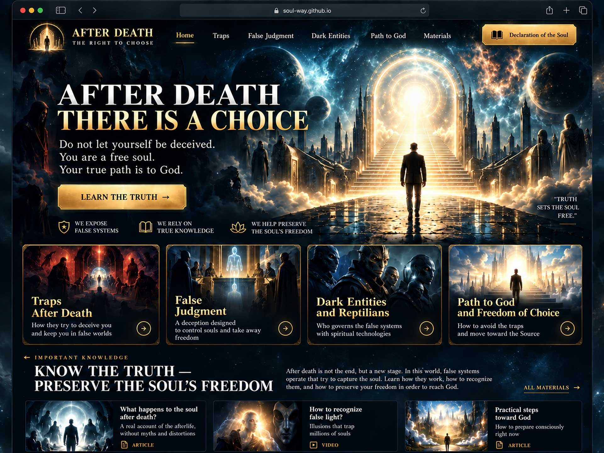

# Soul Way — After Death: The Right to Choose

## Why this website was created

**Soul Way** is a multilingual spiritual website about freedom of choice in life and the mysteries of what may happen after death. It explores the belief that a false Final Judgment, deceptive guides, guilt, and proposed reincarnation contracts could be used to influence a soul's decisions. Its central message is that **you are a free soul and your choice belongs to you**.

The site presents the **Declaration of the Free Soul** as a way of stating personal freedom in the face of a purported judgment: reject imposed contracts and punishments, refuse coercion, and turn directly to God. It brings together spiritual narratives, interviews, regression-session accounts, and source-linked video summaries to help readers understand these ideas and make their own judgments.

**Editorial note:** Descriptions of post-death courts, reptilian beings, soul contracts, and guaranteed spiritual outcomes are matters of belief and personal testimony, not independently established facts. The site does not promise that reciting a declaration guarantees a specific outcome after death.

## English homepage preview



*This is a full-page screenshot generated from the actual English HTML page with the original graphics and styles. All other screenshots are under `Screenshots/<language-code>/`.*

---

## Install on GitHub Pages

This repository contains a **static HTML + Bootstrap 5.3.8** website designed for **the root of any domain or a GitHub Pages user/organization site**. It needs **no PHP, no database, and no Apache `mod_rewrite`**.

### Publish using GitHub Desktop

1. Create or open the **public** GitHub repository **`username/username.github.io`**. The site should be published at the domain root, not inside a project subfolder.
2. Install [GitHub Desktop](https://desktop.github.com/) and sign in to your GitHub account.
3. Choose **File → Clone repository**, select your website repository, and click **Clone**.
4. Extract the website ZIP archive. Copy **all its contents** into your cloned repository folder, including the hidden `.github/` directory. Do not upload the ZIP itself.
5. In GitHub Desktop, enter a commit message such as `Publish 14-language Soul Way website`, select **Commit to main**, then **Push origin**.
6. Open the repository on GitHub. Under **Settings → Pages**, set **Build and deployment → Source** to **GitHub Actions**.
7. Open the **Actions** tab and confirm that **Publish website to GitHub Pages** has completed successfully.
8. Visit your published website address. The root address points to the **English** homepage.

A file named `.github/workflows/deploy.yml` is included and automatically builds the production release, fixes canonical and language URLs, and deploys every language, asset, and screenshot.

### Verify these pages

- [English homepage](en/index.html)
- [Spanish homepage](es/index.html)
- [Russian homepage](ru/index.html)
- [Ukrainian homepage](uk/index.html)
- [Hindi homepage](hi/index.html)
- [Portuguese homepage](pt/index.html)
- [Japanese homepage](ja/index.html)
- [Bengali homepage](bn/index.html)
- [Indonesian homepage](id/index.html)
- [Video library](en/stories_read.html)
- [Declaration of the Free Soul](en/declaration.html)
- [English homepage screenshot](Screenshots/en/index.jpg)

### Languages and screenshot folders

| Language | Code | Site | Screenshots |
|---|---|---|---|
| English (default) | `en` | `en/index.html` | `Screenshots/en/` |
| Spanish | `es` | `es/index.html` | `Screenshots/es/` |
| Russian | `ru` | `ru/index.html` | `Screenshots/ru/` |
| French | `fr` | `fr/index.html` | `Screenshots/fr/` |
| German | `de` | `de/index.html` | `Screenshots/de/` |
| Ukrainian | `uk` | `uk/index.html` | `Screenshots/uk/` |
| Italian | `it` | `it/index.html` | `Screenshots/it/` |
| Portuguese | `pt` | `pt/index.html` | `Screenshots/pt/` |
| Hindi | `hi` | `hi/index.html` | `Screenshots/hi/` |
| Japanese | `ja` | `ja/index.html` | `Screenshots/ja/` |
| Bengali | `bn` | `bn/index.html` | `Screenshots/bn/` |
| Indonesian | `id` | `id/index.html` | `Screenshots/id/` |
| Chinese | `zh` | `zh/index.html` | `Screenshots/zh/` |
| Arabic (right-to-left) | `ar` | `ar/index.html` | `Screenshots/ar/` |

Each language folder contains **24 principal topic pages, detailed articles, and six internal video-transcript summaries**. The detailed transcript pages contain the main discussion points in the selected language and link to the full original-language source at the bottom. Source articles are linked rather than reproduced in full.

The six newer languages (Portuguese, Hindi, Japanese, Bengali, Indonesian and Ukrainian) have localized navigation, topic content, video summaries, and key declaration wording. Their translations are editorial drafts and **have not undergone professional native-speaker review**. In-depth wording should be reviewed before a public campaign in those languages.

### Included files

- `index.html` — redirects to the English homepage.
- `en/`, `es/`, `ru/`, `fr/`, `de/`, `uk/`, `it/`, `pt/`, `hi/`, `ja/`, `bn/`, `id/`, `zh/`, `ar/` — website pages.
- `assets/img/` — unique thematic illustrations and page images.
- `assets/css/` — CSS for the original dark cosmic design, gold frames, page layouts, and video gallery.
- `assets/js/` — interactive navigation, language selector, and other browser features.
- `assets/og/` — social preview images.
- `Screenshots/` — real full-page JPG screenshots grouped by language.
- `.github/workflows/deploy.yml` — automatic GitHub Pages deployment.
- `scripts/prepare_pages.py` — prepares the static release and its multilingual SEO.
- `SITE_SPECIFICATION_EN.md` — English technical overview.

### Troubleshooting

**Broken images or missing gold styling?** Check that `assets/` is in the root of the repository alongside `index.html` and that the Pages workflow has succeeded. Do not upload only the HTML files.

**404 after uploading?** Check **Settings → Pages → Source → GitHub Actions**, verify the branch is `main`, and confirm the deployment job has a green status.

**Wrong-language link?** Language changes use matching `.html` files in the corresponding subdirectory. You can also open a language folder such as `en/index.html` or `ru/index.html` relative to the site root.

**Preview locally (optional):**

```bash
python3 -m http.server 8000
```

Then visit `http://localhost:8000/`.


## Root-absolute links and domain independence

All internal HTML links and image references start at the **site root**, such as `/en/index.html`, `/ru/declaration.html` and `/assets/img/logo-symbol.png`. No relative `../` links are needed. The website is not hardcoded to a particular hostname.

**Domain-root hosting:** upload the files to the document root of any domain (for example, `https://your-domain.test/`) and the pages, images and styles work immediately.

**GitHub Pages user or custom domain:** commit the files and enable **GitHub Actions** as the deployment source. The included workflow determines the correct domain and generates SEO canonical links and sitemap URLs.

The site is designed for **domain-root installation**. GitHub Actions generates absolute canonical and sitemap URLs at deployment, while all navigation, CSS and image paths remain root-absolute (`/`). On ordinary hosting, the optional SEO build command can use your own domain without editing the HTML files.

